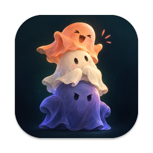
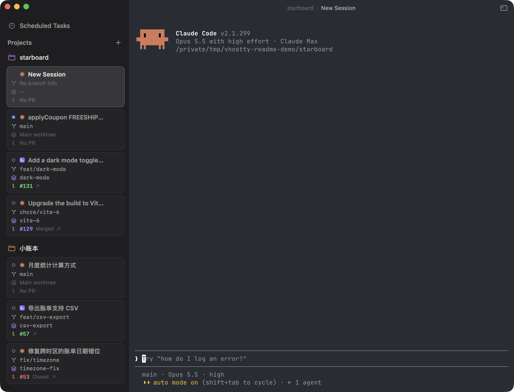

<p align="center"></p>

<h1 align="center">Vertty</h1>

<p align="center"><b>A terminal for agents with project-based tabs, iOS remote access, and scheduled tasks.</b></p>

<p align="center">English · <a href="README.zh-CN.md">简体中文</a></p>

Vertty is a native macOS terminal for agents, built on libghostty. It organizes active and historical sessions by project.

<p align="center"></p>

## Features

- **Project & session management**: organize sessions by project, track agent status, and resume past conversations.
- **iOS remote access**: access and control sessions from an iPhone, iPad or another Mac, over built-in Tailscale (sign in on both ends) or your own network.
- **Scheduled tasks**: run Claude Code and Codex tasks on a schedule, with natural language support for creating and managing them. Choose a time zone per task to follow daylight saving changes automatically.
- **Sleep prevention**: prevent sleep with the lid closed and keep the display on while tasks run.
- **Bottom shell**: open a shell below each session that follows its current directory.
- **Ghostty configuration**: reuse your existing fonts, theme and keybindings.

## Supported agents

Currently supports Claude Code and Codex.

## Installing

Apple Silicon Macs, macOS 14 or later:

```bash
brew tap SunRunAway/tap
brew install --cask SunRunAway/tap/vertty
```

This installs Vertty into `/Applications` using our [Homebrew tap](https://github.com/SunRunAway/homebrew-tap). Update with `brew update && brew upgrade --cask vertty`.

For installation without Homebrew, see [manual installation](docs/manual-installation.md).

For source builds and debugging, see the [developer documentation](DEVELOPER.md) (in Chinese).
